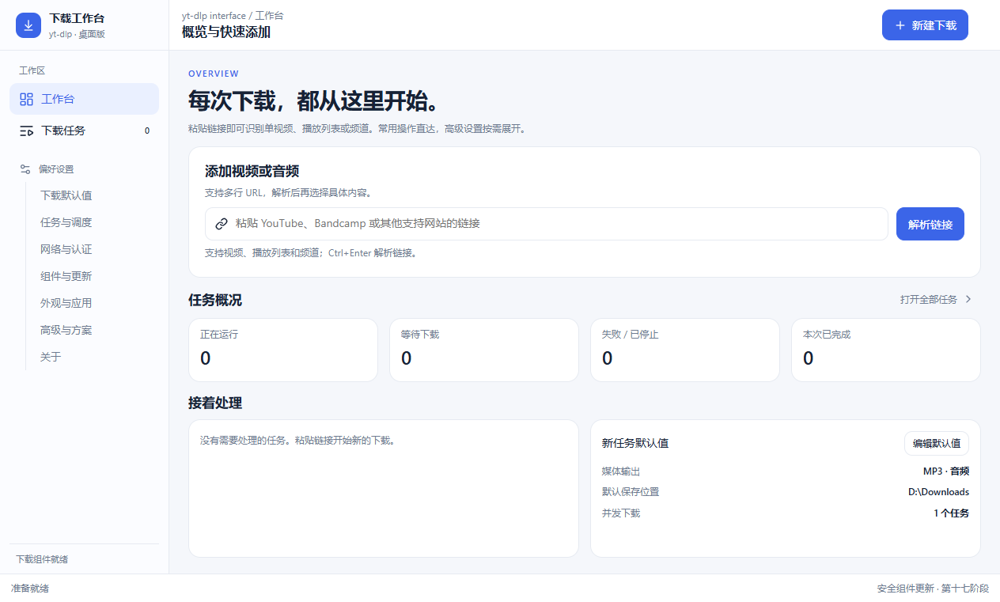
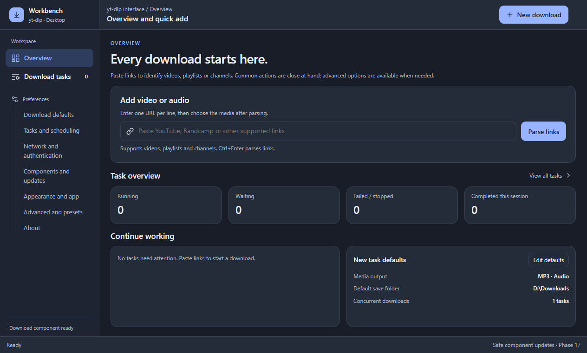

<div align="center">

# yt-dlp 下载工作台

**用中文管理视频与音频下载，从粘贴链接到整理文件。**

Windows 桌面应用 · 简体中文 / English · 浅色 / 深色主题

[](https://github.com/Yes-nolink/ytdlp-interface-zh-cn/releases/latest)
[](#下载与运行)
[](LICENSE)

[下载便携版](https://github.com/Yes-nolink/ytdlp-interface-zh-cn/releases/latest) · [使用说明](#开始下载) · [源码构建](#从源码构建) · [反馈问题](https://github.com/Yes-nolink/ytdlp-interface-zh-cn/issues)

</div>



基于 [ErrorFlynn/ytdlp-interface v2.19.1](https://github.com/ErrorFlynn/ytdlp-interface/tree/v2.19.1) 改造的 Windows 图形界面。当前版本使用 WebView2 展示下载工作台，由 C++ 核心调用 yt-dlp 和 FFmpeg 执行下载与处理。

这是一项独立维护的界面改造，保留上游版权与 MIT 许可。网站支持范围和媒体解析结果由 [yt-dlp](https://github.com/yt-dlp/yt-dlp) 决定。

## 可以做什么

| 能力 | 使用方式 |
| --- | --- |
| 视频、播放列表与频道 | 粘贴一个或多个链接，解析后按条目或范围选择下载内容 |
| 视频与音频输出 | 选择分辨率、音视频格式，下载视频或提取 MP3 / M4A 音频 |
| 字幕、封面与元数据 | 选择字幕和音轨，按需嵌入封面、字幕及媒体信息 |
| 下载任务与集合 | 查看进度，停止、重试、筛选、分组，展开集合管理子任务 |
| 并发与队列恢复 | 设置并发下载和解析数量，恢复未完成任务 |
| 文件命名与方案 | 用中文字段组合文件名，保存命名方案、参数方案和下载方案 |
| 网络与认证 | 配置代理、浏览器 Cookies 或 Cookies 文件 |
| 组件管理 | 检查组件版本、配置路径，更新已有 yt-dlp / FFmpeg，以及安装或更新 Deno |
| 双语与外观 | 简体中文和英文界面，系统、浅色和深色主题 |

常用操作集中在工作台和下载任务页；七类偏好设置可从左栏直接进入。长列表、设置正文和抽屉分别滚动，标题与操作区保持可见。

<details>
<summary>查看英文深色界面</summary>



A Windows desktop GUI for yt-dlp with a WebView2 workbench, a C++ download core, playlist selection, queue management, output presets, and Chinese / English interfaces.

</details>

## 下载与运行

1. 打开 [Releases](https://github.com/Yes-nolink/ytdlp-interface-zh-cn/releases/latest)，下载 `ytdlp-interface-zh-cn-*-windows-x64.zip`，完整解压到一个独立目录。
2. 确认已安装 [Microsoft Edge WebView2 Runtime](https://developer.microsoft.com/en-us/microsoft-edge/webview2/)。缺少时安装 Evergreen Runtime 的 x64 版本。
3. 准备下表中的下载组件，将对应 EXE 放在程序目录中；已有组件也可通过「组件与更新」配置路径。
4. 运行 `ytdlp-interface.exe`，在「组件与更新」中检查组件是否可用。

**便携 ZIP 包含界面程序、界面资源、语言文件和许可证；yt-dlp、FFmpeg、ffprobe、Deno 需另行准备。** 使用 Windows 版 `yt-dlp.exe` 无需另装 Python。

| 组件 | 作用 | 下载来源 |
| --- | --- | --- |
| `yt-dlp.exe` | 解析链接与下载媒体 | [yt-dlp 官方 Windows x64 版](https://github.com/yt-dlp/yt-dlp/releases/latest/download/yt-dlp.exe) |
| `ffmpeg.exe`、`ffprobe.exe` | 音视频合并、转码与媒体信息 | [yt-dlp FFmpeg Builds](https://github.com/yt-dlp/FFmpeg-Builds/releases/latest)，选择 Windows x64 构建并提取这两个文件 |
| `deno.exe` | yt-dlp 的 JavaScript 运行支持 | [Deno 官方发布](https://github.com/denoland/deno/releases/latest)，选择 `deno-x86_64-pc-windows-msvc.zip` |

推荐的目录结构：

```text
ytdlp-interface-zh-cn/
├─ ytdlp-interface.exe
├─ yt-dlp.exe
├─ ffmpeg.exe
├─ ffprobe.exe
├─ deno.exe
├─ ui/
├─ locales/
├─ licenses/
└─ LICENSE
```

不要只复制界面 EXE；`ui` 和 `locales` 必须随程序保留。Deno 放在 yt-dlp 所在目录，或通过系统 PATH 提供。

## 开始下载

1. 在工作台粘贴视频、播放列表或频道链接，点击「解析链接」。多条链接可按行粘贴。
2. 在来源抽屉选择需要的条目，进入下载设置。
3. 选择视频或音频输出、格式质量、保存目录；按需设置字幕、封面和文件命名。
4. 加入队列或立即下载，在「下载任务」中查看进度、日志和输出文件。

下载纯音频时选择 MP3 或 M4A，并按需开启嵌入封面和元数据。调整未来任务的默认配置，进入左栏「下载默认值」；修改具体任务则从任务详情进入编辑。

在「外观与应用」中切换界面语言，重启后生效。切换语言会保留用户保存的方案名称、文件名和下载设置；网站返回的标题与组件原始日志保留原文。

## 更新与常见问题

- **打开程序提示缺少运行环境：** 安装 WebView2 Runtime，并保留完整的 `ui`、`locales` 目录。
- **链接无法解析或下载失败：** 查看任务日志，检查网络、代理、Cookies 和 yt-dlp 版本；网站自身的限制仍会影响下载。
- **合并或转码失败：** 检查 FFmpeg 与 ffprobe 是否成对存在，组件路径是否正确。
- **更新组件：** 在「组件与更新」中先检查更新，再按提示操作。首次准备 yt-dlp 和 FFmpeg 需手动下载；Deno 支持在应用内安装。
- **更新界面程序：** 从本仓库 Releases 下载新包并解压到新目录。当前界面自身的自动更新入口禁用，避免被上游原版覆盖。

个人设置、队列与窗口状态默认保存在 `%LOCALAPPDATA%\ytdlp-interface` 下。移除便携程序目录不会删除已下载的媒体文件；旧 Nana 队列不支持导入。当前版本提供浅色、深色和系统主题，不支持旧版自定义主题。真实跨屏混合 DPI 和物理触控板操作仍有待进一步验证。

## 从源码构建

需要 Windows x64、PowerShell、MSVC C++23 编译器、Windows SDK、ATL、CMake 3.20+ 和 Ninja。可安装 Visual Studio Build Tools 的「使用 C++ 的桌面开发」工作负载，并勾选 ATL 与 CMake 工具。

在 **x64 Developer PowerShell for Visual Studio** 中执行：

```powershell
git clone https://github.com/Yes-nolink/ytdlp-interface-zh-cn.git
cd ytdlp-interface-zh-cn
./build.ps1
./.build/web-package/ytdlp-interface.exe
```

脚本自动获取固定版本的 WebView2 SDK；运行时仍需安装 WebView2 Runtime。zlib 源码随仓库提供，图标脚本与 JSON 头文件也已包含，无需安装前端包。

默认构建目录为 `.build/web-app`，输出包为 `.build/web-package`。输出目录必须全新或为空；再次打包可指定新目录：

```powershell
./build.ps1 -OutputDirectory ./release/my-build
```

本地已有的 `.build` 便携工具链仍可使用。脚本只修改当前进程环境。下载组件不参与界面编译，构建后按前面的运行步骤准备即可。

## 项目结构

```text
src/        C++ 下载核心与 Windows / WebView2 宿主
ui/         HTML、CSS、JavaScript 界面和图标资源
locales/    简体中文与英文语言文件
vendor/     构建所需的 zlib 源码
licenses/   上游与第三方许可声明
docs/images/ 首页展示截图
build.ps1   构建与打包脚本
```

公开仓库从当前最终源码快照开始，不包含个人配置、Cookies、临时构建、验证脚本、验证报告或旧安装包。

## 来源与许可

应用沿用 [MIT License](LICENSE)，保留原作者 ErrorFlynn 的版权声明。修改与再分发时请保留许可与版权信息。

感谢 [ytdlp-interface](https://github.com/ErrorFlynn/ytdlp-interface)、[yt-dlp](https://github.com/yt-dlp/yt-dlp)、[FFmpeg](https://ffmpeg.org/)、[Deno](https://github.com/denoland/deno)、[WebView2](https://developer.microsoft.com/en-us/microsoft-edge/webview2/)、[nlohmann/json](https://github.com/nlohmann/json)、[zlib](https://zlib.net/) 和 [Lucide](https://lucide.dev/)。各组件的许可独立适用，声明见 [licenses](licenses/README.md)。

请仅下载你有权获取的内容，并遵守相关网站的使用条款。
